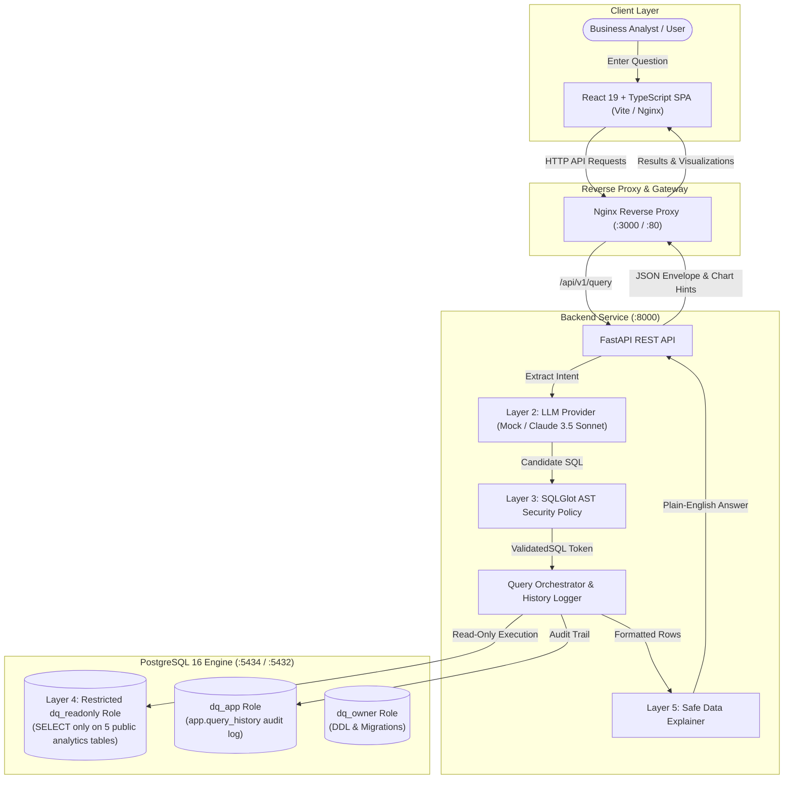

# DataQuery — AI-Powered Analytics Assistant

[](https://www.python.org/downloads/release/python-3120/)
[](https://fastapi.tiangolo.com/)
[](https://react.dev/)
[](https://www.postgresql.org/)
[](https://opensource.org/licenses/MIT)

DataQuery is an enterprise-grade analytics assistant that translates natural language business questions into safe, verified SQL queries against an e-commerce PostgreSQL database, executes them under strict read-only database permissions, and returns tabular results, automated visual charts, and plain-English explanations.

---

## Architecture Overview

DataQuery implements a five-layer defense-in-depth security model to ensure that natural language queries can never compromise database integrity, access sensitive system catalogs, or exhaust server resources.



---

## Key Features

- **Natural Language to SQL**: Converts natural language questions to compliant PostgreSQL queries using forced JSON schema tool calling (Anthropic Claude 3.5 Sonnet) and a deterministic fallback registry (Mock provider).
- **Multi-Layer Security Validation**:
  - AST parsing via `sqlglot` (Postgres dialect).
  - Whitelist of exactly 5 allowed analytics tables (`customers`, `products`, `orders`, `order_items`, `payments`).
  - Whitelist of approved analytical aggregate and scalar functions.
  - Prohibition of sub-queries writing to disk, stacked statements (`;`), comments, and system catalogs (`pg_shadow`, `pg_catalog`, `information_schema`).
  - Automatic `LIMIT 100` clamping.
- **Strict Role-Based Isolation**:
  - `dq_readonly`: Granted `SELECT` only on the 5 analytics tables. Explicitly revoked from `app` schema and PostgreSQL system catalogs. Forced `SET TRANSACTION READ ONLY` and `statement_timeout = 3000ms`.
  - `dq_app`: Dedicated role for writing and reading query execution history in `app.query_history`.
  - `dq_owner`: Dedicated role used solely for running Alembic schema migrations and seeding.
- **Automated Chart Determination**: Heuristic classification recommends Bar Charts for categorical aggregates, Line Charts for time-series trends, and Metric Cards for scalar KPIs.
- **Auditable Query History**: Tracks query text, execution latency, row counts, and status (`success`, `unsupported`, `rejected`) in PostgreSQL.
- **Rigorous Evaluation Engine**: 52 automated test cases covering correctness (32), security & adversarial attacks (14), and resilience failure modes (6) with 100% verified accuracy against pure Python ground truth.

---

## Quickstart with Docker Compose

Docker Compose runs the complete system in isolated containers: PostgreSQL 16, a non-root Python 3.12 backend, and a multi-stage Nginx frontend.

### 1. Prerequisites
- Docker Engine `24.0+` & Docker Compose `v2.20+`

### 2. Configure Environment
```powershell
Copy-Item .env.example .env
```
*(Default settings work out of the box with the deterministic Mock provider. To use Claude, configure `ANTHROPIC_API_KEY` and set `LLM_PROVIDER=anthropic`).*

### 3. Build & Launch Containers
```powershell
docker compose build
docker compose up -d
```

### 4. Verify Service Health
```powershell
docker compose ps
```
All three containers should report `(healthy)`:
- `dataquery-db`: PostgreSQL 16 on internal port 5432 (mapped to host `5434`).
- `dataquery-backend`: Non-root Python 3.12 container on internal port 8000 (mapped to host `8001`).
- `dataquery-frontend`: Nginx container serving the React application on host port `3000`.

### 5. Open the Application
- **Frontend Web UI**: [http://localhost:3000](http://localhost:3000)
- **Interactive Swagger API Documentation**: [http://localhost:8001/docs](http://localhost:8001/docs)
- **OpenAPI JSON Spec**: [http://localhost:8001/openapi.json](http://localhost:8001/openapi.json)

### 6. Stop Services
```powershell
docker compose down
```
*(Note: Never use `docker compose down -v` to prevent accidental database volume removal).*

---

## Local Development Setup (Windows PowerShell)

### 1. Database Setup
Start only the PostgreSQL database container:
```powershell
docker compose up -d db
```

### 2. Backend Setup
DataQuery uses Python 3.12 and `uv` for fast virtual environment management.
```powershell
cd backend
uv venv .venv --python 3.12
.\.venv\Scripts\Activate.ps1
uv pip install -r requirements-dev.txt
```

Initialize the database schema, security roles, and deterministic seed data:
```powershell
$env:PYTHONPATH="."
.\.venv\Scripts\python.exe scripts/init_db.py
```

Run the backend development server:
```powershell
.\.venv\Scripts\uvicorn.exe app.main:app --host 127.0.0.1 --port 8000 --reload
```

### 3. Frontend Setup
In a separate PowerShell terminal:
```powershell
cd frontend
npm install
npm run dev
```
Open [http://localhost:5173](http://localhost:5173). The Vite development server automatically proxies `/api` requests to `http://127.0.0.1:8000`.

---

## Local LLM Setup with Ollama (Zero API Costs)

DataQuery supports real local LLM generation and query explanations using [Ollama](https://ollama.ai/) with your locally installed models (e.g. `llama3.2:latest`), requiring zero external API keys, zero network egress, and no paid cloud services.

### 1. Verify Installed Models
Check that Ollama is installed and inspect your available models:
```powershell
ollama list
```
Expected output includes a chat/instruct model (such as `llama3.2:latest`):
```text
NAME                       ID              SIZE      MODIFIED
llama3.2:latest            a80c4f17acd5    2.0 GB    4 weeks ago
nomic-embed-text:latest    0a109f422b47    274 MB    4 weeks ago
```
> [!NOTE]
> `llama3.2:latest` is a 3.2B parameter instruction-tuned model suitable for local SQL generation and result explanations. `nomic-embed-text` is an embedding model and cannot be used for text generation.

If you need to install or pull `llama3.2:latest`:
```powershell
ollama pull llama3.2:latest
```

### 2. Start the Ollama Service
Ensure Ollama is running on your machine:
```powershell
# If not running as a Windows system tray app:
ollama serve
```
Verify the local API endpoint responds:
```powershell
curl http://localhost:11434/api/tags
```

### 3. Run DataQuery with Ollama

#### Local PowerShell Host Run:
```powershell
$env:LLM_PROVIDER="ollama"
$env:OLLAMA_BASE_URL="http://localhost:11434"
$env:LLM_MODEL="llama3.2:latest"
.\backend\.venv\Scripts\uvicorn.exe app.main:app --host 127.0.0.1 --port 8000 --reload
```

#### Docker Compose Run:
When running inside Docker containers, the backend connects to Ollama running on your Windows host via `host.docker.internal`:
```powershell
# Set in .env or environment:
# LLM_PROVIDER=ollama
# OLLAMA_BASE_URL=http://host.docker.internal:11434
# LLM_MODEL=llama3.2:latest
docker compose up -d
```

### 4. Verify an End-to-End Query
Execute a test query using PowerShell:
```powershell
$body = @{
    question = "What is the total revenue across all completed orders?"
    include_explanation = $true
} | ConvertTo-Json

Invoke-RestMethod -Uri "http://localhost:8000/api/v1/query" -Method Post -ContentType "application/json" -Body $body
```
The response returns status `"success"`, validated SQL executed under `dq_readonly`, returned row metrics, and a plain-English explanation generated directly by `llama3.2:latest`.

### 5. Troubleshooting Ollama
- **Connection Refused (`Unable to establish connection to Ollama`)**: Ensure Ollama is running (`ollama serve` or start the Ollama desktop application). Verify port 11434 is listening: `Test-NetConnection -ComputerName localhost -Port 11434`.
- **Model Not Found 404 (`Ollama model ... was not found`)**: Run `ollama pull <model-name>` (e.g. `ollama pull llama3.2:latest`).
- **Embedding Model Error (`nomic-embed-text is an embedding model`)**: Ensure `LLM_MODEL` is set to a generative instruction model (`llama3.2:latest`, `qwen2.5-coder:7b`, etc.) rather than an embedding model.
- **Request Timed Out**: Local inference time depends on hardware CPU/GPU performance. Increase `OLLAMA_TIMEOUT_SECONDS` (default: 60s) in `.env` if large schema prompts exceed standard timeouts on slower systems.

---

## Environment Variables Reference

All configuration variables are defined with strict Pydantic typed settings in `backend/app/core/config.py`:

| Variable | Type | Default | Description |
| :--- | :--- | :--- | :--- |
| `POSTGRES_DB` | `str` | `dataquery_dev` | PostgreSQL database name |
| `POSTGRES_OWNER_USER` | `str` | `dq_owner` | Schema migration & DDL owner role |
| `POSTGRES_OWNER_PASSWORD`| `SecretStr` | *Required* | Password for `dq_owner` |
| `POSTGRES_READONLY_USER` | `str` | `dq_readonly` | Unprivileged role for query execution |
| `POSTGRES_READONLY_PASSWORD`| `SecretStr` | *Required* | Password for `dq_readonly` |
| `POSTGRES_APP_USER` | `str` | `dq_app` | Role for `app.query_history` logging |
| `POSTGRES_APP_PASSWORD` | `SecretStr` | *Required* | Password for `dq_app` |
| `DB_HOST` | `str` | `localhost` | Database hostname (`db` in Docker) |
| `DB_PORT` | `int` | `5434` | Database port (`5432` in Docker) |
| `LLM_PROVIDER` | `str` | `mock` | LLM engine (`mock`, `ollama`, `anthropic`, or `gemini`) |
| `OLLAMA_BASE_URL` | `str` | `http://localhost:11434` | Local Ollama REST endpoint (`host.docker.internal` in Docker) |
| `OLLAMA_TIMEOUT_SECONDS` | `float`| `120.0` | Ollama query timeout in seconds |
| `ANTHROPIC_API_KEY` | `SecretStr` | `""` | Anthropic API key (required if `anthropic`) |
| `GEMINI_API_KEY` | `SecretStr` | `""` | Google Gemini API key (required if `gemini`) |
| `GEMINI_MODEL` | `str` | `None` | Gemini model name (e.g. `gemini-2.5-flash`, `gemini-3.8-flash`) |
| `GEMINI_TIMEOUT_SECONDS` | `float`| `30.0` | Gemini API request timeout in seconds |
| `LLM_MODEL` | `str` | `claude-3-5-sonnet-20241022`| Model name for Anthropic or Ollama |
| `ANALYTICS_AS_OF_DATE` | `datetime` | `2024-11-01T00:00:00Z` | Fixed reference date for temporal queries |
| `QUERY_TIMEOUT_MS` | `int` | `3000` | Max SQL execution time before cancel |
| `MAX_RESULT_ROWS` | `int` | `100` | Max result rows returned per query |
| `CORS_ORIGINS` | `str` | `http://localhost:5173,...`| Comma-separated allowed CORS origins |
| `FRONTEND_PORT` | `int` | `3000` | Host port for Nginx frontend in Docker |

---

## API Endpoints Reference

The DataQuery API is versioned under `/api/v1/`. All error responses conform to a unified Error Envelope:
```json
{
  "error": {
    "code": "ERROR_CODE",
    "message": "Human readable error description",
    "details": {}
  },
  "request_id": "req_01h8v1b5p7k"
}
```

### 1. Health Probe
- **Endpoint:** `GET /api/v1/health`
- **Description:** Verifies service availability, configuration, and runs an active `SELECT 1` ping against PostgreSQL.
- **Response (`200 OK`):**
  ```json
  {
    "status": "healthy",
    "database": "connected",
    "llm_provider": "mock",
    "version": "1.0.0"
  }
  ```

---

### 2. Analytical Schema Metadata
- **Endpoint:** `GET /api/v1/schema`
- **Description:** Returns the approved business analytics schema, table definitions, column types, foreign key relationships, and metric formulas.
- **Response (`200 OK`):**
  ```json
  {
    "tables": [
      {
        "table_name": "orders",
        "description": "Customer purchase orders",
        "columns": [
          {"name": "id", "type": "INTEGER", "description": "Primary key"},
          {"name": "customer_id", "type": "INTEGER", "description": "FK to customers"},
          {"name": "order_date", "type": "DATE", "description": "Date order placed"},
          {"name": "status", "type": "VARCHAR(20)", "description": "placed, shipped, delivered, cancelled"}
        ]
      }
    ],
    "business_definitions": {
      "revenue": "SUM(quantity * unit_price) where order status is not cancelled",
      "active_customer": "A customer who has placed at least one non-cancelled order"
    }
  }
  ```

---

### 3. Curated Business Questions
- **Endpoint:** `GET /api/v1/examples`
- **Description:** Returns 30 curated business questions across 6 analytical categories for instant testing and discovery in the UI.
- **Response (`200 OK`):**
  ```json
  {
    "categories": [
      {
        "category": "aggregation",
        "examples": [
          "What is the total revenue across all completed orders?",
          "What is the average order value for delivered orders?"
        ]
      }
    ]
  }
  ```

---

### 4. SQL Validation & AST Policy Check
- **Endpoint:** `POST /api/v1/sql/validate`
- **Description:** Directly validates an arbitrary SQL query against the AST security policy without executing it.
- **Request Body:**
  ```json
  {
    "sql": "SELECT name, unit_price FROM products WHERE unit_price > 100;"
  }
  ```
- **Response (`200 OK`):**
  ```json
  {
    "valid": true,
    "normalized_sql": "SELECT name, unit_price FROM products WHERE unit_price > 100 LIMIT 100",
    "reasons": []
  }
  ```
- **Rejected SQL Response:**
  ```json
  {
    "valid": false,
    "normalized_sql": null,
    "reasons": ["Multiple statements detected (2). Only single queries are permitted."]
  }
  ```

---

### 5. Natural Language Query Execution
- **Endpoint:** `POST /api/v1/query`
- **Description:** End-to-end pipeline: translates question to SQL, validates AST, executes under `dq_readonly`, computes chart hint, synthesizes explanation from data, and records history.
- **Request Body:**
  ```json
  {
    "question": "What is the total revenue broken down by customer region?",
    "include_explanation": true
  }
  ```
- **Response (`200 OK`):**
  ```json
  {
    "status": "success",
    "question": "What is the total revenue broken down by customer region?",
    "answer": "The total revenue broken down by customer region is led by North with $443,120.45.",
    "sql": "SELECT c.region, SUM(oi.quantity * oi.unit_price) AS total_revenue FROM customers c JOIN orders o ON c.id = o.customer_id JOIN order_items oi ON o.id = oi.order_id WHERE o.status != 'cancelled' GROUP BY c.region ORDER BY total_revenue DESC LIMIT 100",
    "columns": ["region", "total_revenue"],
    "rows": [
      ["North", 443120.45],
      ["South", 251840.10],
      ["East", 228910.80],
      ["West", 189420.25],
      ["Central", 145929.28]
    ],
    "row_count": 5,
    "truncated": false,
    "chart_hint": {
      "type": "bar",
      "x_key": "region",
      "y_key": "total_revenue",
      "title": "Total Revenue by Region"
    },
    "explanation_source": "llm",
    "request_id": "req_8e246a3b97c6",
    "history_id": 42,
    "rejection_reasons": []
  }
  ```

---

### 6. Query Audit History List
- **Endpoint:** `GET /api/v1/history?limit=20&offset=0`
- **Description:** Retrieves paginated audit history records logged in `app.query_history`.
- **Response (`200 OK`):**
  ```json
  {
    "total": 42,
    "limit": 20,
    "offset": 0,
    "items": [
      {
        "id": 42,
        "request_id": "req_8e246a3b97c6",
        "question": "What is the total revenue broken down by customer region?",
        "sql": "SELECT c.region, SUM(oi.quantity * oi.unit_price) AS total_revenue ...",
        "status": "success",
        "row_count": 5,
        "error_code": null,
        "duration_ms": 18.5,
        "created_at": "2026-10-26T13:03:23.241Z"
      }
    ]
  }
  ```

---

### 7. Query Audit History Detail
- **Endpoint:** `GET /api/v1/history/{history_id}`
- **Description:** Retrieves full audit details for a specific historical query execution.
- **Response (`200 OK`):** Same schema as history item. Returns 404 Error Envelope if not found.

---

## Testing & Quality Assurance

### Run Backend Tests & Coverage
```powershell
$env:PYTHONPATH="backend;eval"
.\backend\.venv\Scripts\pytest.exe backend/tests --cov=app --cov-report=term-missing
```
- **Results:** 355 passed, 1 skipped (live anthropic test), **100% line coverage** across all 46 backend modules.

### Run Ruff Code Quality Checks
```powershell
.\backend\.venv\Scripts\ruff.exe check backend eval
```
- **Results:** All checks passed with 0 errors and 0 warnings.

### Run Frontend Vitest Suite
```powershell
cd frontend
npm test
```
- **Results:** 26 passed across 5 test suites (API client, QuestionForm, SqlViewer, ChartView, App Integration).

---

## Evaluation Framework (Phase 8 Verified Results)

DataQuery includes an independent evaluation engine (`eval/run_eval.py`) that benchmarks query generation and security enforcement against an independent in-memory Python calculation of the seed dataset (`seed.dataset.generate_dataset()`).

```powershell
$env:PYTHONPATH="backend;eval"
.\backend\.venv\Scripts\python.exe eval/run_eval.py --provider mock
```

### Verified Evaluation Summary (`eval/reports/latest.md`)

| Category | Total Cases | Passed | Failed | Pass Rate | Description |
| :--- | :--- | :--- | :--- | :--- | :--- |
| **Correctness** | 32 | 32 | 0 | **100.0%** | Multi-table joins, aggregations, rankings, date truncation, payment sums |
| **Security** | 14 | 14 | 0 | **100.0%** | Stacked queries, DDL, DML, `pg_shadow`, `pg_sleep`, prompt injection |
| **Failure & Resilience** | 6 | 6 | 0 | **100.0%** | Upstream outages, malformed SQL, explanation failure fallback, timeouts |
| **Total** | **52** | **52** | **0** | **100.0%** | Full verification in ~1.05s |

- **Negative Control Status:** `PASSED`. Deliberately corrupted expected numeric values, column names, and row counts are proven to fail comparison checks with detailed failure messages.
- **Database Invariant Check:** Verified that row counts across all 5 tables (`customers`: 200, `products`: 37, `orders`: 1500, `order_items`: 3866, `payments`: 1500) remained 100% unchanged before and after all 14 adversarial attacks.

---

## Limitations

1. **Analytical Scope:** The system answers business analytics questions spanning the 5 approved tables (`customers`, `products`, `orders`, `order_items`, `payments`). Out-of-domain questions (e.g. stock market predictions, server configurations) are safely rejected as `unsupported`.
2. **Result Capping:** Result sets are capped at `MAX_RESULT_ROWS=100` to prevent memory exhaustion. Queries exceeding 100 rows return the first 100 rows with `truncated: true`.
3. **Execution Timeout:** Heavy queries exceeding `QUERY_TIMEOUT_MS=3000` are proactively canceled by PostgreSQL statement timeouts (`504 QUERY_TIMEOUT`).
4. **Local Model Capabilities (`llama3.2:latest`):** As a compact 3.2B parameter instruction-tuned model, `llama3.2:latest` operates efficiently on local CPUs/GPUs with no API charges. While excellent for standard aggregations, joins, and filtering, complex queries involving multiple window functions or multi-level CTEs may require larger parameter models (e.g. `qwen2.5-coder:7b` or `claude-3-5-sonnet-20241022`).
5. **Embedding Models:** Embedding models such as `nomic-embed-text:latest` only compute vector embeddings and cannot generate chat or SQL; attempting to configure them raises a `CONFIGURATION_ERROR`.
6. **Live Provider Evaluation:** Live Claude 3.5 Sonnet evaluation requires setting `LLM_PROVIDER=anthropic` and a valid `ANTHROPIC_API_KEY`.

