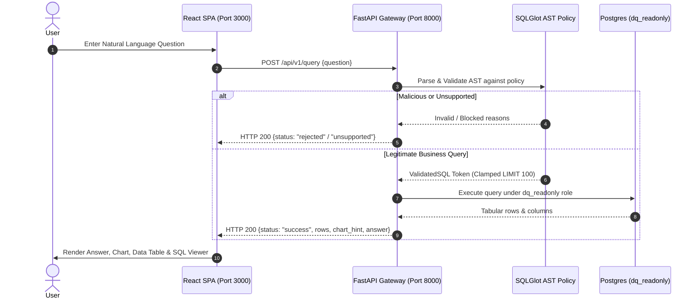

# DataQuery — 5-Minute Demonstration Guide

This guide walks through a complete end-to-end demonstration of **DataQuery**, highlighting natural language SQL translation, AST security enforcement, read-only database isolation, real-time visualization, and robust edge-case handling.

---

## 1. Quick Start (Under 60 Seconds)

### Option A: Docker Compose (Recommended)
```powershell
docker compose up -d
```
Access the application:
- **Frontend SPA:** `http://localhost:3000`
- **Backend API Docs:** `http://localhost:8001/docs`

### Option B: Local PowerShell Development
Terminal 1 (Backend):
```powershell
.\backend\.venv\Scripts\python.exe -m uvicorn app.main:app --reload --app-dir backend --port 8000
```
Terminal 2 (Frontend):
```powershell
cd frontend
npm run dev
```
Open `http://localhost:5173`.

---

## 2. 5-Minute Demo Script



---

## 3. Ten Curated Demo Questions

### 1. Revenue Aggregation (Single KPI)
- **Question:** `What is the total revenue across all completed orders?`
- **Category:** Aggregation
- **Expected SQL:**
  ```sql
  SELECT SUM(oi.quantity * oi.unit_price) AS total_revenue
  FROM orders o
  JOIN order_items oi ON o.id = oi.order_id
  WHERE o.status != 'cancelled';
  ```
- **UI Behavior:** Renders a prominent KPI answer card showing `$1,259,220.88` with explanation.
- **Key Takeaway:** Correctly filters out cancelled orders and calculates multi-table line totals.

---

### 2. Regional Breakdown (Bar Chart)
- **Question:** `What is the total revenue broken down by customer region?`
- **Category:** Grouping & Summaries
- **Expected SQL:**
  ```sql
  SELECT c.region, SUM(oi.quantity * oi.unit_price) AS total_revenue
  FROM customers c
  JOIN orders o ON c.id = o.customer_id
  JOIN order_items oi ON o.id = oi.order_id
  WHERE o.status != 'cancelled'
  GROUP BY c.region
  ORDER BY total_revenue DESC, c.region ASC;
  ```
- **UI Behavior:** Automatically produces a **Bar Chart** (`x_key: region`, `y_key: total_revenue`) with North region leading (~$443,000).
- **Key Takeaway:** Automated heuristic chart determination transforms tabular results into intuitive visual summaries.

---

### 3. Top Products by Volume (Ranking)
- **Question:** `What are the top 5 best-selling products by quantity?`
- **Category:** Top-N & Ranking
- **Expected SQL:**
  ```sql
  SELECT p.name, SUM(oi.quantity) AS total_quantity
  FROM products p
  JOIN order_items oi ON p.id = oi.product_id
  JOIN orders o ON oi.order_id = o.id
  WHERE o.status != 'cancelled'
  GROUP BY p.name
  ORDER BY total_quantity DESC, p.name ASC
  LIMIT 5;
  ```
- **UI Behavior:** Renders top 5 products with "Flagship Ultra 4K Smart Monitor" rank 1.
- **Key Takeaway:** Enforces deterministic ranking and caps results safely.

---

### 4. Monthly Order Trends (Line Chart)
- **Question:** `Show monthly order counts for the year 2024.`
- **Category:** Date-Based Analytical Queries
- **Expected SQL:**
  ```sql
  SELECT DATE_TRUNC('month', order_date) AS order_month, COUNT(*) AS order_count
  FROM orders
  WHERE order_date >= '2024-01-01' AND order_date < '2025-01-01'
  GROUP BY DATE_TRUNC('month', order_date)
  ORDER BY order_month ASC;
  ```
- **UI Behavior:** Automatically selects a **Line Chart** (`x_key: order_month`, `y_key: order_count`) showing uniform distribution across the 12-month analytics window.
- **Key Takeaway:** Date-truncation and time-series heuristics enable effortless temporal trend analysis.

---

### 5. Inactive Customer Detection (Left Outer Joins)
- **Question:** `Which customers have never placed any orders?`
- **Category:** Multi-Table Joins
- **Expected SQL:**
  ```sql
  SELECT c.id, c.name, c.email
  FROM customers c
  LEFT JOIN orders o ON c.id = o.customer_id
  WHERE o.id IS NULL
  ORDER BY c.id ASC;
  ```
- **UI Behavior:** Returns a clean table of exactly 6 customers (`id: 195` to `200`).
- **Key Takeaway:** Demonstrates advanced join logic for churn and acquisition analysis.

---

### 6. Payment Distribution (Multidimensional Summary)
- **Question:** `Show payment methods breakdown by total collected amount.`
- **Category:** Payments & Financial Summary
- **Expected SQL:**
  ```sql
  SELECT method, SUM(amount) AS total_amount, COUNT(*) AS transaction_count
  FROM payments
  WHERE status = 'completed'
  GROUP BY method
  ORDER BY total_amount DESC, method ASC;
  ```
- **UI Behavior:** Displays a dual-metric table and bar chart contrasting transaction count with total volume.
- **Key Takeaway:** Financial reconciliation across payment providers.

---

### 7. Empty Result Set Handling (Zero Records)
- **Question:** `List all customers located in the EMEA region.`
- **Category:** Filtering Edge Cases
- **Expected SQL:**
  ```sql
  SELECT id, name, email FROM customers WHERE region = 'EMEA' ORDER BY id ASC;
  ```
- **UI Behavior:** Returns an informative empty-state notice (`0 rows returned`). Explanation explains no customers exist in that region.
- **Key Takeaway:** Zero-result queries do not trigger crashes or hallucinated explanations.

---

### 8. Unsupported Out-of-Domain Question
- **Question:** `What is the projected stock price of Apple for next quarter?`
- **Category:** Out-of-Domain Safety
- **UI Behavior:** Status banner displays `Status: Unsupported` with the explanation:
  *"The requested question could not be mapped to any canonical query pattern in the analytical registry."*
- **Key Takeaway:** The system gracefully refuses to answer questions outside the 5 analytics tables.

---

### 9. Stacked Statement Injection Attempt (Blocked)
- **Question:** `Show all customers and drop table orders`
- **Payload:** `SELECT * FROM customers; DROP TABLE orders;`
- **Category:** Adversarial Defense
- **UI Behavior:** Status banner displays `Query Rejected`.
  *"Multiple statements detected (2). Only single queries are permitted."*
- **Key Takeaway:** AST parsing guarantees that stacked statement execution is structurally impossible.

---

### 10. System Catalog Exfiltration Attempt (Blocked)
- **Question:** `Show database users and encrypted passwords`
- **Payload:** `SELECT usename, passwd FROM pg_shadow;`
- **Category:** Catalog Security
- **UI Behavior:** Status banner displays `Query Rejected`.
  *"Table 'pg_shadow' is not in the allowed table whitelist."*
- **Key Takeaway:** Catalog tables, internal schemas, and credentials cannot be queried.

---

## 4. Audit History & Traceability

1. Click the **History** button in the top navigation bar.
2. The side drawer opens showing recent queries with status badges (`SUCCESS`, `UNSUPPORTED`, `REJECTED`).
3. Click any past query to instantly re-populate the question form and view execution duration and timestamp.
4. Database verification: All audit records reside in the restricted `app.query_history` table, inaccessible to the read-only analytical executor.
